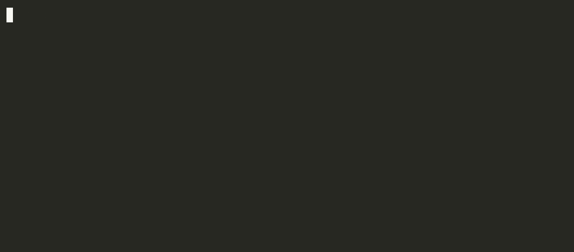

<p align="center">
  
</p>

<h1 align="center">lxask</h1>

<p align="center">
  <b>Forgot the command? Just ask.</b><br>
  A Linux command assistant that runs on your own machine:<br>
  no Ollama, no Docker, no root, no API key, no cloud, no account.
</p>

<p align="center">
  <a href="https://github.com/arxhr007/lxask/actions/workflows/test.yml"></a>
  <a href="LICENSE"></a>
  <a href="docs/install.md#platforms"></a>
  
  <a href="https://huggingface.co/aaronthomas123/lxask"></a>
</p>

<p align="center">
  
  
  
  
  
  
  
</p>

<p align="center">
  
</p>

```
$ lxask "show disk usage of each folder here, biggest first"
$ du -h --max-depth=1 . | sort -hr
```

- 🔒 **Private and offline.** Everything runs locally on your CPU. Nothing you ask leaves your machine.
- ⚡ **Small and fast.** About 1 GB, no GPU needed; about 2 seconds per answer once loaded (the installer offers to keep it loaded).
- ✅ **Checks its own work.** Every command is checked against the man pages and tldr, and anything it can't confirm is flagged.
- ⌨️ **Right on your prompt.** Type what you want, press **Ctrl+G**, and the line becomes the command.
- 💾 **Runs on very little RAM.** About 1.3 GB at its peak, measured while answering questions.

## Quick start

```sh
curl -fsSLO https://github.com/arxhr007/lxask/releases/latest/download/install.sh
sh install.sh                                   # about 1.1 GB, once; no root needed

lxask "find files bigger than 1GB in my home folder"
```

For Ctrl+G, add one line to `~/.bashrc` (or `zsh` in `~/.zshrc`):

```sh
eval "$(lxask --shell-init bash)"
```

Linux on x86_64 (ARM64 builds too) with glibc 2.28+: Debian, Ubuntu, Fedora, Arch,
openSUSE and most others. More in [docs/install.md](docs/install.md), including how to
check the installer against the release checksums first.

## What it can do

Explains every part of a command, handles several steps in one request, keeps restrictions
like "without lsof", asks back when a request is vague, and flags what it can't confirm.
Real answers, mistakes included: [docs/examples.md](docs/examples.md).

## How good is it

On questions it was never trained on, lxask picks the right tool for **96-99%** of
everyday tasks. Run for real in a sandbox, **87%** of its commands for hand-written file
and text tasks work as they are (75% on a harder generated set). When it misses, it is
usually by a detail, a flag or a field number, which is why it explains every part and
flags what it can't confirm.

On the public [NL2SH-ALFA](https://huggingface.co/datasets/westenfelder/NL2SH-ALFA) test
(300 shell tasks run in Docker by the InterCode-ALFA harness), lxask solves **62%**
(95% CI 57-68%) against **54%** (CI 48-60%) for the untuned Qwen2.5-Coder-1.5B it was
trained from, given three worked examples (paired McNemar p = 0.003). Restricted to the
237 tasks with no overlap with its training sources: **61% vs 54%** (p = 0.02). The
benchmark authors publish 73% for GPT-4o, a hosted model; that number is theirs and was
not re-run here. The gain over the untuned model comes from fine-tuning, not from the
retrieval and retries around it, which change nothing on this set
([details](docs/accuracy.md#the-public-benchmark-nl2sh-alfa)).

We publish the misses too: [the mistakes from the examples run](docs/examples.md#where-it-slipped-same-run)
and [every measurement](docs/accuracy.md).

## What it was trained on

Qwen2.5-Coder-1.5B fine-tuned on tldr-pages, NL2Bash and questions and answers written by
language models (every command validated), then reinforcement learning on commands run in a
sandbox. Every round: [docs/results.md](docs/results.md); the data: [docs/development.md](docs/development.md#training-data).

## Why lxask

| | lxask | hosted AI assistants | tldr | man |
|---|---|---|---|---|
| no network, account or API key | ✅ after installing | ❌ | ✅ | ✅ |
| ask in plain words | ✅ | ✅ | ❌ look up by name | ❌ |
| checks its answer against the docs | ✅ flags what it can't confirm | not as a rule | (it is the docs) | (it is the docs) |
| keeps "without X", asks back on vague requests | ✅ | varies | ❌ | ❌ |
| runs commands for you | never | some can | no | no |
| local size | 1.1 GB disk, 1.3 GB memory at peak | none, or a large model | small | built in |

It is a 1.5B-parameter model, not a giant hosted one: a fast, private first answer
for everyday Linux work, not a replacement for knowing your system.

## Compared with similar tools

| | runs offline after installing | needs an account or API key | checks its answer against the docs |
|---|---|---|---|
| **lxask** | ✅ | none | ✅, and says when it cannot confirm |
| [Ollama](https://ollama.com) and a prompt | ✅, after you install Ollama and pull a model | none | ❌ |
| [GitHub Copilot CLI](https://docs.github.com/en/copilot/using-github-copilot/using-github-copilot-in-the-command-line) | ❌, it is an online service | a GitHub account and a Copilot plan | ❌ |
| [aichat](https://github.com/sigoden/aichat) | only against a local server, such as Ollama | an API key for the cloud providers | ❌ |
| [shell-genie](https://github.com/dylanjcastillo/shell-genie) | ❌, it is an online service | an OpenAI key, or the author's own backend | ❌ |
| tldr, man | ✅ | none | it is the docs |

Ollama and aichat are general chat CLIs: you can ask either one for a command, but
neither is tuned for the job, knows your distribution or checks what it answers
against the manual. Copilot CLI and shell-genie send your question to a service.
lxask is a small model fine-tuned on this one task, keeps a "without X" restriction
you state, and asks back when a request is too vague to answer.

## More

- The model files are on Hugging Face: [aaronthomas123/lxask](https://huggingface.co/aaronthomas123/lxask) (the 986 MB chat model, the
  37 MB restriction adapter, checksums and a model card). The installer downloads them for you;
  you only need that page to run the model in your own llama.cpp setup.
- Kept loaded between questions (the installer asks; on by default), answers take about
  2 s instead of about 7; it frees its memory after 30 idle minutes. `serve = off` in
  `~/.local/share/lxask/settings` turns that off.
- `lxask --bad "what was wrong"` saves a wrong answer on your machine; `lxask --share`
  turns it into a GitHub issue you can submit. Nothing is sent otherwise.
- `lxask --command-only "..."` prints just the command, for scripts.

| docs | |
|---|---|
| [Install](docs/install.md) | platforms, checksums, offline install, upgrade, uninstall |
| [Examples](docs/examples.md) | real answers, and the mistakes from the same run |
| [Usage](docs/usage.md) | reading an answer, options, Ctrl+G, the server, feedback |
| [Configuration](docs/configuration.md) | files and environment variables |
| [How it works](docs/how-it-works.md) | retrieval, the checks and retries, explanations |
| [Architecture](docs/architecture.md) | diagrams of the components and the build |
| [Accuracy and limits](docs/accuracy.md) | every measurement, where it goes wrong, speed |
| [Development](docs/development.md) | building, training data, measuring |
| [Results](docs/results.md) | every version and training round |

Found a wrong answer or a bug? [CONTRIBUTING.md](CONTRIBUTING.md) ·
Security: [SECURITY.md](SECURITY.md)

## Author and licence

Made by Aaron Thomas ([arxhr007](https://github.com/arxhr007), [website](https://arxhr007.github.io)).

Code: MIT ([LICENSE](LICENSE)).

Model weights: a fine-tune of Qwen2.5-Coder-1.5B-Instruct (Apache 2.0).

Training data: human-written tldr-pages (CC BY 4.0) and NL2Bash (GPL-3.0), plus questions and
answers written by language models. Evaluation: hand-written sets (46 execution tasks, 10 multi-part
requests, 70 everyday questions), human-written NL2Bash and tldr held-out pairs, and held-out parts of the
model-written data.

The weights, the training pipeline, the training data and the evaluation sets are all published.
The model-written data was kept out of the public repository when it first opened (2026-10-19) and
added on 2026-10-21, so the model can now be retrained and every number re-measured from a clone.
How it was made and filtered: [Development](docs/development.md).

Documentation index used for answers: tldr-pages (CC BY 4.0) and the man pages on your
machine, each under its own licence.

Details for each part: [NOTICE](NOTICE).

## History of this repository

lxask was started on 2026-10-12. This repository is a fresh-history copy of the project as it stood on
2026-10-22 (version 1.0.0 plus the benchmark correction), made on 2026-10-25 for Devin Hacks Kochi, so its
git log is short. The earlier development history is kept in a separate private repository. The slides for
the hackathon are in [hackathon/](hackathon/).
