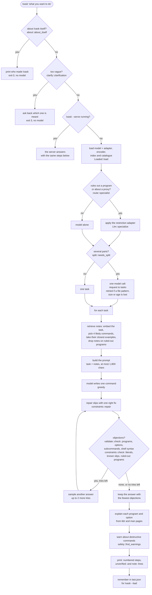
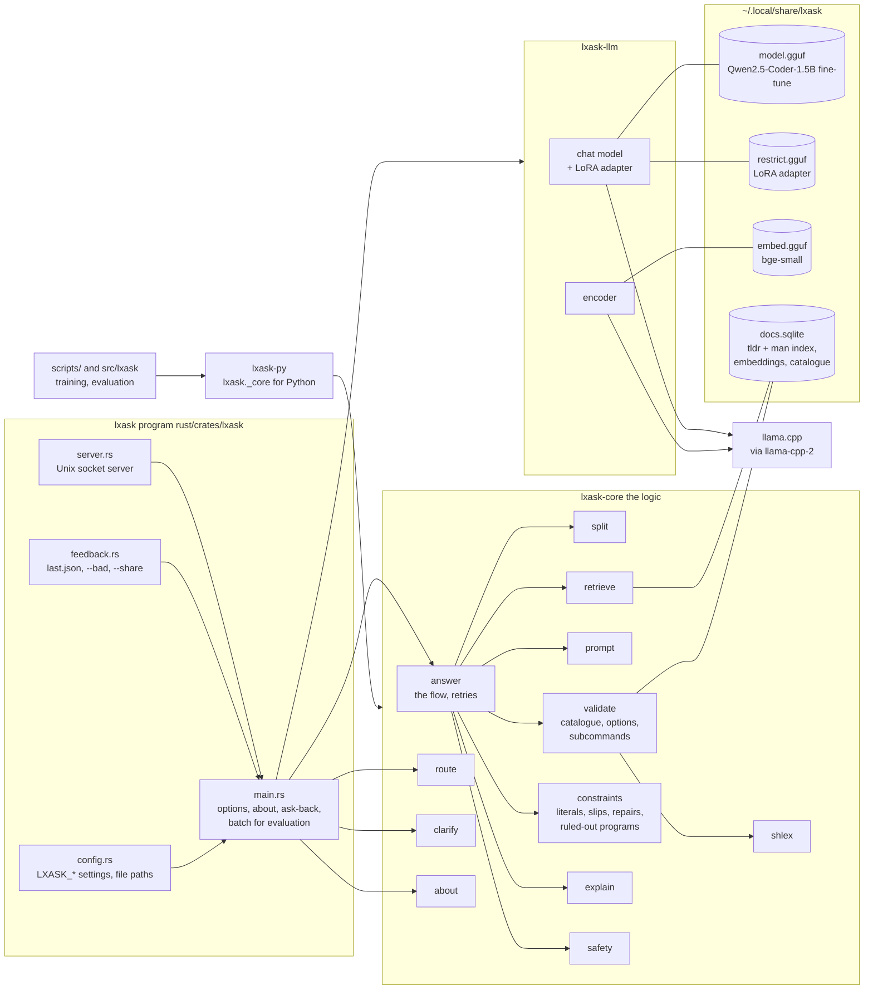
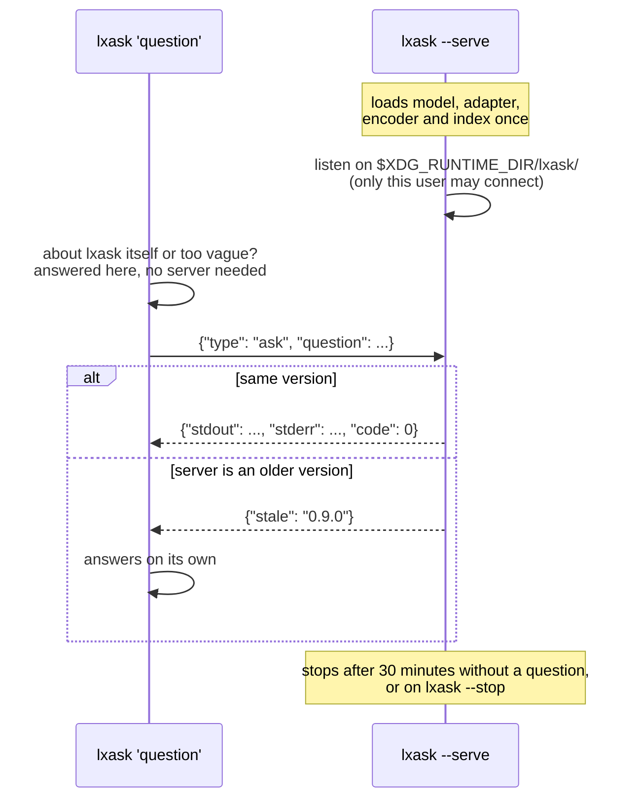
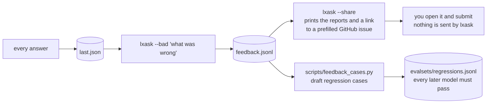
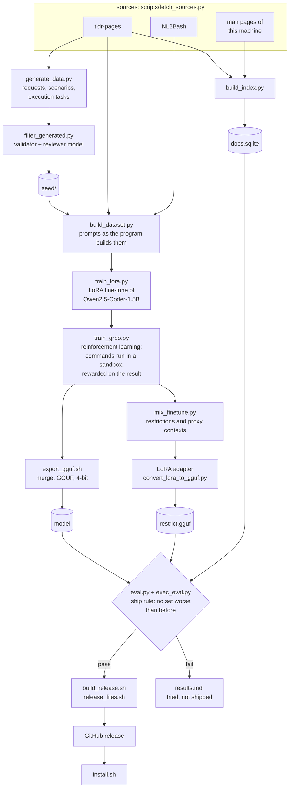

# Architecture

lxask is one Rust program and four files: the model, its restriction adapter, a small
encoder and a SQLite index of documentation. Everything runs on your machine, on the
CPU. Python is used only to build those files and to measure the result, and it calls
the same Rust core the program uses, so what is measured is what ships.

For the reasoning behind each step in prose, see [how-it-works.md](how-it-works.md);
for numbers, [results.md](results.md).

## Answering a request

What happens between `lxask "..."` and the printed command
(`rust/crates/lxask/src/main.rs`, `rust/crates/lxask-core/src/answer.rs`):

Two shortcuts answer without the model at all: questions about lxask itself, and
requests too vague for one command ("add a proxy"). Everything else goes through the
model, one call per task plus one for the split, and up to two more per task when the
checks object.

## Components

| crate | what it is |
|---|---|
| `lxask` | the program: options, the server, feedback, settings |
| `lxask-core` | every rule, with no I/O: the model and the search are passed in, so it is tested without them |
| `lxask-llm` | the model, the adapter and the encoder, through llama.cpp |
| `lxask-py` | the core as the Python module `lxask._core`, used by `src/lxask` and `scripts/` |

## The server

`lxask --serve` keeps everything loaded, so later questions skip the few seconds of
loading. With `serve = auto` (the installer's default) a question that finds no
server starts one in the background, detached from the terminal, and waits for it;
a lock next to the socket makes sure only one is started (`server::start_and_wait`).

## Feedback

## How the model and the index are made

Offline, on a machine with a GPU (a free Colab T4 or a laptop RTX card):

The evaluation sets are kept out of training throughout; the execution tests run each
command as an unprivileged user in a container with no network
([development.md](development.md#measuring-it)).

## Files on disk

Everything lives in `~/.local/share/lxask`: the model, the adapter, the encoder, the
index, `last.json` and your `feedback.jsonl`; the program is `~/.local/bin/lxask`.
The full list and every setting: [configuration.md](configuration.md).

## Design choices

- **Check, don't trust.** A 1.5B model gets details wrong, so every command is
  checked against the documentation and the request, retried when a check objects,
  and marked `unverified:` when it still fails. It never runs a command.
- **Small, local, offline.** One program and about 1.1 GB of files, 1.3 GB of memory
  while answering, no network after installing.
- **Route instead of retrain.** The model fine-tuned on restrictions got worse on
  everyday questions, so it ships as an adapter used only for the requests it is
  better at ([results.md](results.md)).
- **Ask back instead of guessing** when a request means different commands in
  different contexts.
- **Fixed text for questions about lxask**, rather than teaching the model facts
  about itself.
- **One core for the program and the measurements.** Training and evaluation call
  the same Rust code through `lxask._core`.
